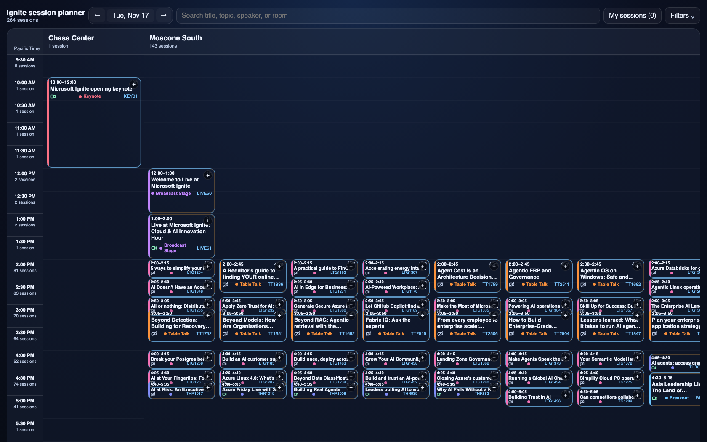

# Ignite Session Planner

The [Microsoft Session Catalog](https://ignite.microsoft.com/en-US/sessions) didn't quite fit the way I wanted to visualise and plan my sessions for Microsoft Ignite 2026, so I created this simple web app to help me plan my sessions.

## Analytics

The planner can send page views and JavaScript exception telemetry to Azure Application Insights. To enable it, create an Application Insights resource and replace `YOUR_CONNECTION_STRING` in `ignite_planner.html` with the resource's connection string. Until configured, the SDK is not loaded and no analytics data is sent. The connection string is used by this browser app and is not a secret.

## License

This project is released into the public domain under the [Unlicense](LICENSE).
